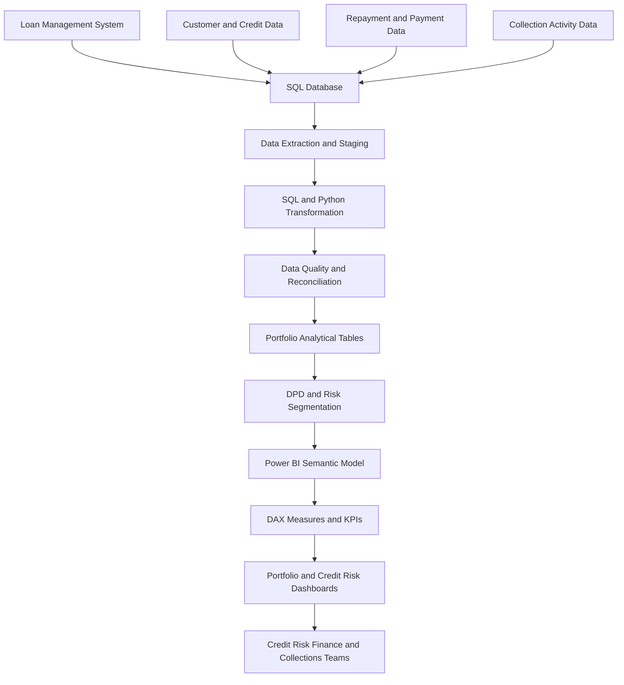
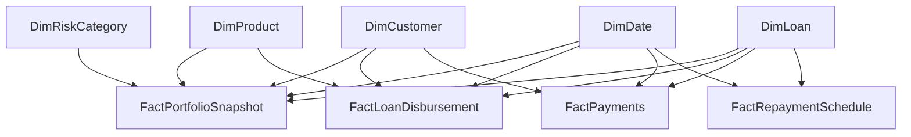

# Loan Portfolio & Credit Risk Analytics

### End-to-End Digital Lending & Credit Risk Intelligence Solution


---

## Project Overview

This project demonstrates an end-to-end loan portfolio
and credit risk analytics solution designed to support
digital lending and financial services organizations.

The solution integrates loan application data, customer
information, credit scores, loan disbursements, repayment
schedules and payment transactions into a centralized
analytical model.

Interactive Power BI dashboards enable Credit, Risk,
Finance, Collections and Portfolio Management teams to
monitor portfolio performance, identify high-risk segments,
analyze delinquency trends and support data-driven
lending decisions.

---

## Business Impact

The solution is designed to support:

- Improved visibility into loan portfolio performance.
- Early identification of delinquent loan accounts.
- Identification of high-risk customer segments.
- Improved monitoring of outstanding portfolio exposure.
- Standardized credit risk and lending KPI definitions.
- Improved understanding of customer repayment behavior.
- Reduced dependency on manual portfolio reporting.
- Better collaboration across Credit, Risk and Collections.
- Data-driven underwriting and portfolio management.
- Improved monitoring of portfolio quality over time.

---

## Problem Statement

Digital lending organizations manage large volumes of
loan applications, customer information, disbursements
and repayment transactions.

When this information is distributed across multiple
systems, it becomes difficult to establish a consolidated
view of portfolio performance and credit risk.

Key challenges include:

- Limited visibility into overall portfolio health.
- Difficulty identifying high-risk loan accounts.
- Inconsistent delinquency and risk calculations.
- Manual preparation of portfolio performance reports.
- Limited visibility into customer repayment behavior.
- Difficulty monitoring overdue loan balances.
- Limited understanding of risk concentration.
- Challenges in evaluating underwriting performance.
- Delayed identification of deteriorating loan cohorts.

---

## Business Objectives

- Develop a centralized loan portfolio analytics solution.
- Monitor loan disbursement and outstanding principal.
- Analyze loan application and approval trends.
- Identify delinquent and high-risk loan accounts.
- Segment customers using credit scores and risk attributes.
- Monitor Days Past Due (DPD) and portfolio at risk.
- Analyze repayment and collection performance.
- Evaluate portfolio performance across loan cohorts.
- Identify risk concentration across business segments.
- Automate recurring portfolio and credit risk reporting.
- Support underwriting and portfolio management decisions.

---

## Data Overview

### Data Sources

- Loan application data
- Customer master data
- Loan account information
- Credit bureau information
- Underwriting and approval data
- Loan disbursement records
- Repayment schedules
- Payment transaction data
- Collection activity records
- Loan status and closure information
- Historical portfolio snapshots

### Data Granularity

- Customer-level information
- Loan application-level information
- Loan account-level information
- Installment-level repayment schedules
- Payment transaction-level records
- Loan-level monthly portfolio snapshots
- Disbursement cohort-level performance

### Important Data Fields

| Field | Description |
|---|---|
| LoanID | Unique loan account identifier |
| CustomerID | Unique customer identifier |
| ApplicationID | Unique loan application identifier |
| ApplicationDate | Date of loan application |
| DisbursementDate | Date of loan disbursement |
| LoanAmount | Original disbursed principal |
| OutstandingPrincipal | Remaining unpaid principal |
| InterestRate | Applicable loan interest rate |
| LoanTenure | Loan repayment duration |
| EMIAmount | Scheduled installment amount |
| CreditScore | Customer credit bureau score |
| DueDate | Scheduled installment due date |
| PaymentDate | Actual payment date |
| PaymentAmount | Amount received from the borrower |
| DaysPastDue | Number of overdue days |
| LoanStatus | Current loan account status |
| RiskCategory | Assigned analytical risk segment |
| SnapshotDate | Portfolio reporting date |

---

## Solution Architecture



---

## Technology Stack

| Technology | Purpose |
|---|---|
| SQL | Data extraction and analytical queries |
| Python | Data processing and analytical automation |
| Pandas | Data cleansing and risk segmentation |
| Power BI | Interactive analytical dashboards |
| DAX | Portfolio and credit risk calculations |
| Power Query | Data preparation and transformation |
| Excel | Data validation and reconciliation |
| GitHub | Version control and documentation |

---

## Data Model

The analytical solution follows dimensional modeling
principles to support scalable loan portfolio reporting.

### Representative Fact Tables

| Table | Description |
|---|---|
| FactLoanApplications | Loan applications and underwriting decisions |
| FactLoanDisbursement | Loan disbursement transactions |
| FactRepaymentSchedule | Scheduled installment information |
| FactPayments | Actual repayment transactions |
| FactPortfolioSnapshot | Historical loan balances and risk status |
| FactCollections | Collection activities and outcomes |

### Representative Dimension Tables

| Table | Description |
|---|---|
| DimDate | Calendar and reporting periods |
| DimCustomer | Customer master information |
| DimLoan | Loan account and contract information |
| DimProduct | Loan product classification |
| DimGeography | Customer geographical information |
| DimRiskCategory | Risk segmentation categories |
| DimLoanStatus | Loan status classification |
| DimLendingPartner | Lending partner information |

### Semantic Model



### Relationship Design

- One-to-many relationships between dimensions and facts.
- Shared customer and loan dimensions.
- Consistent loan identifiers across analytical tables.
- Clearly defined transaction and snapshot granularity.
- Separate reporting dates and disbursement cohort dates.
- Single-direction filtering where appropriate.
- Avoidance of unnecessary many-to-many relationships.

Portfolio balances are snapshot-based metrics and should
not be summed across multiple reporting dates.

---

## Implementation Approach

### 1. Business Requirement Analysis

- Understand lending and credit risk requirements.
- Identify important portfolio performance metrics.
- Define delinquency and risk classification rules.
- Establish reporting granularity.
- Identify stakeholder reporting requirements.

### 2. Data Extraction

- Extract loan application and disbursement data.
- Retrieve customer and credit bureau information.
- Extract repayment schedules and payment transactions.
- Retrieve historical loan portfolio snapshots.
- Integrate collection activity information.

### 3. Data Transformation

- Develop SQL-based transformation logic.
- Use joins, CTEs and window functions.
- Standardize customer and loan identifiers.
- Handle missing values and duplicate records.
- Standardize loan status classifications.
- Validate financial and repayment information.

### 4. Loan Portfolio Snapshot Development

- Establish a consistent reporting date.
- Calculate outstanding principal balances.
- Identify active and closed loan accounts.
- Calculate overdue installment balances.
- Determine loan-level Days Past Due.
- Maintain historical portfolio snapshots.

### 5. Credit Risk Segmentation

- Segment customers using credit score ranges.
- Classify loan accounts using DPD buckets.
- Analyze risk across loan products and regions.
- Identify high-risk loan cohorts.
- Monitor portfolio exposure by risk category.

### 6. Repayment Analysis

- Compare scheduled and actual repayments.
- Analyze overdue installment balances.
- Monitor payment delays and missed payments.
- Identify recurring repayment behavior.
- Evaluate collection performance.

### 7. Data Quality and Validation

- Validate loan and customer identifiers.
- Identify duplicate loan records.
- Validate disbursement amounts.
- Reconcile outstanding principal balances.
- Validate repayment schedules.
- Reconcile actual payment transactions.
- Validate reporting date consistency.

### 8. Data Modeling

- Develop fact and dimension tables.
- Establish appropriate relationships.
- Build a centralized Power BI semantic model.
- Develop reusable DAX measures.
- Optimize analytical reporting performance.

### 9. Dashboard Development

- Develop interactive portfolio dashboards.
- Create credit risk scorecards.
- Analyze delinquency trends.
- Develop loan cohort analysis.
- Implement drill-down and filtering capabilities.
- Present actionable business insights.

---

## Credit Risk Segmentation

### Days Past Due (DPD)

Days Past Due represents the number of days an unpaid
or partially unpaid installment remains overdue.

Loan-level DPD is generally determined using the
oldest unpaid installment as of the reporting date.

### DPD Bucket Classification

| DPD Range | Risk Classification |
|---|---|
| 0 DPD | Current |
| 1-30 DPD | Early Delinquency |
| 31-60 DPD | Moderate Delinquency |
| 61-90 DPD | High Delinquency |
| Above 90 DPD | Severe Delinquency |

These are representative analytical classifications.
Regulatory NPA classification must follow the applicable
lending and regulatory requirements.

### Credit Score Segmentation

| Credit Score | Illustrative Risk Segment |
|---|---|
| 750 and above | Lower Risk |
| 700-749 | Moderate Risk |
| 650-699 | Elevated Risk |
| Below 650 | Higher Risk |
| Missing or Invalid | Unclassified |

Credit score thresholds are illustrative and should be
aligned with the applicable credit policy and bureau scale.

Credit score alone does not determine creditworthiness.

---

## Key Performance Indicators

| KPI | Business Definition |
|---|---|
| Total Applications | Number of loan applications received |
| Approved Applications | Number of approved loan applications |
| Approval Rate | Approved applications relative to decided applications |
| Total Disbursement | Total principal amount disbursed |
| Disbursed Loans | Number of loans disbursed |
| Average Ticket Size | Average disbursed loan amount |
| Active Loans | Number of active loan accounts |
| Outstanding Principal | Remaining unpaid principal balance |
| Overdue Amount | Unpaid amount past its scheduled due date |
| Delinquent Loans | Active loans with DPD greater than zero |
| Delinquency Rate | Delinquent active loans relative to active loans |
| PAR 30+ | Outstanding principal of loans at least 30 DPD relative to total active outstanding principal |
| PAR 90+ | Outstanding principal of loans at least 90 DPD relative to total active outstanding principal |
| Default Rate | Defaulted loans relative to a defined eligible loan population |
| Collection Efficiency | Payments allocated to current-period dues relative to scheduled current-period dues |
| Bounce Rate | Bounced payment attempts relative to eligible payment attempts |
| Average Credit Score | Average valid credit score across the selected population |

---

## Sample SQL Implementation

### 1. Loan-Level DPD Calculation

```sql
DECLARE @ReportingDate DATE = '2026-10-31';

WITH OverdueInstallments AS
(
    SELECT
        LoanID,
        MIN(DueDate) AS OldestUnpaidDueDate
    FROM RepaymentScheduleSnapshot
    WHERE SnapshotDate = @ReportingDate
      AND DueDate < @ReportingDate
      AND RemainingDueAmount > 0
    GROUP BY LoanID
)
SELECT
    L.LoanID,
    L.OutstandingPrincipal,
    COALESCE(
        DATEDIFF(
            DAY,
            O.OldestUnpaidDueDate,
            @ReportingDate
        ),
        0
    ) AS DaysPastDue
FROM LoanPortfolioSnapshot L
LEFT JOIN OverdueInstallments O
    ON L.LoanID = O.LoanID
WHERE L.SnapshotDate = @ReportingDate
  AND L.LoanStatus = 'Active';
```

This query identifies the oldest unpaid installment
and calculates loan-level delinquency as of a
consistent reporting date.

---

### 2. DPD Bucket Classification

```sql
SELECT
    LoanID,
    DaysPastDue,
    OutstandingPrincipal,
    CASE
        WHEN DaysPastDue IS NULL
            THEN 'Unknown'
        WHEN DaysPastDue < 0
            THEN 'Invalid'
        WHEN DaysPastDue = 0
            THEN 'Current'
        WHEN DaysPastDue <= 30
            THEN '1-30 DPD'
        WHEN DaysPastDue <= 60
            THEN '31-60 DPD'
        WHEN DaysPastDue <= 90
            THEN '61-90 DPD'
        ELSE '90+ DPD'
    END AS DPDBucket
FROM LoanPortfolioSnapshot;
```

---

### 3. Monthly Loan Disbursement Analysis

```sql
SELECT
    EOMONTH(DisbursementDate) AS ReportingMonth,
    COUNT(DISTINCT LoanID) AS DisbursedLoans,
    SUM(DisbursementAmount) AS TotalDisbursement,
    SUM(DisbursementAmount) /
        NULLIF(COUNT(DISTINCT LoanID), 0)
        AS AverageTicketSize
FROM LoanDisbursement
GROUP BY EOMONTH(DisbursementDate)
ORDER BY ReportingMonth;
```

This query supports monthly disbursement monitoring
and average loan ticket size analysis.

---

### 4. Portfolio at Risk Analysis

```sql
DECLARE @ReportingDate DATE = '2026-10-31';

SELECT
    ProductCategory,
    SUM(OutstandingPrincipal)
        AS TotalOutstanding,

    SUM(
        CASE
            WHEN DaysPastDue >= 30
            THEN OutstandingPrincipal
            ELSE 0
        END
    ) AS PAR30Outstanding,

    CAST(
        100.0 *
        SUM(
            CASE
                WHEN DaysPastDue >= 30
                THEN OutstandingPrincipal
                ELSE 0
            END
        ) /
        NULLIF(SUM(OutstandingPrincipal), 0)
        AS DECIMAL(10,2)
    ) AS PAR30Pct

FROM LoanPortfolioSnapshot
WHERE SnapshotDate = @ReportingDate
  AND LoanStatus = 'Active'
GROUP BY ProductCategory;
```

This query identifies the proportion of outstanding
portfolio exposure associated with delinquent loans.

---

### 5. Credit Score Risk Analysis

```sql
DECLARE @ReportingDate DATE = '2026-10-31';

WITH RiskSegmentation AS
(
    SELECT
        LoanID,
        OutstandingPrincipal,
        DaysPastDue,
        CASE
            WHEN CreditScore IS NULL
                THEN 'Unclassified'
            WHEN CreditScore < 300
              OR CreditScore > 900
                THEN 'Unclassified'
            WHEN CreditScore >= 750
                THEN 'Lower Risk'
            WHEN CreditScore >= 700
                THEN 'Moderate Risk'
            WHEN CreditScore >= 650
                THEN 'Elevated Risk'
            ELSE 'Higher Risk'
        END AS RiskCategory
    FROM LoanPortfolioSnapshot
    WHERE SnapshotDate = @ReportingDate
      AND LoanStatus = 'Active'
)
SELECT
    RiskCategory,
    COUNT(DISTINCT LoanID) AS TotalLoans,
    SUM(OutstandingPrincipal) AS OutstandingAmount,
    COUNT(
        DISTINCT CASE
            WHEN DaysPastDue > 0 THEN LoanID
        END
    ) AS DelinquentLoans,
    CAST(
        100.0 *
        COUNT(
            DISTINCT CASE
                WHEN DaysPastDue > 0 THEN LoanID
            END
        ) /
        NULLIF(COUNT(DISTINCT LoanID), 0)
        AS DECIMAL(10,2)
    ) AS DelinquencyRate
FROM RiskSegmentation
GROUP BY RiskCategory;
```

This analysis compares portfolio exposure and
delinquency across illustrative credit score segments.

---

## Sample Python Implementation

### 1. Data Cleansing and Risk Segmentation

```python
import pandas as pd
import numpy as np

df = pd.read_csv("datasets/loan_portfolio.csv")

df["SnapshotDate"] = pd.to_datetime(
    df["SnapshotDate"],
    errors="coerce"
)

df["CreditScore"] = pd.to_numeric(
    df["CreditScore"],
    errors="coerce"
)

df["DaysPastDue"] = pd.to_numeric(
    df["DaysPastDue"],
    errors="coerce"
)

df["OutstandingPrincipal"] = pd.to_numeric(
    df["OutstandingPrincipal"],
    errors="coerce"
)

df = df.drop_duplicates()

df = df.dropna(
    subset=["LoanID", "SnapshotDate"]
)

if df.duplicated(
    subset=["LoanID", "SnapshotDate"]
).any():
    raise ValueError(
        "Conflicting loan snapshot records detected."
    )

df.loc[
    ~df["CreditScore"].between(300, 900),
    "CreditScore"
] = np.nan

df["RiskCategory"] = np.select(
    [
        df["CreditScore"].isna(),
        df["CreditScore"] >= 750,
        df["CreditScore"] >= 700,
        df["CreditScore"] >= 650
    ],
    [
        "Unclassified",
        "Lower Risk",
        "Moderate Risk",
        "Elevated Risk"
    ],
    default="Higher Risk"
)
```

---

### 2. DPD Bucket Classification

```python
df["DPDBucket"] = pd.cut(
    df["DaysPastDue"],
    bins=[-1, 0, 30, 60, 90, np.inf],
    labels=[
        "Current",
        "1-30 DPD",
        "31-60 DPD",
        "61-90 DPD",
        "90+ DPD"
    ]
)

df["DPDBucket"] = (
    df["DPDBucket"]
    .cat.add_categories(["Unknown"])
    .fillna("Unknown")
)

df.loc[
    df["DaysPastDue"] < 0,
    "DPDBucket"
] = "Unknown"
```

---

### 3. Portfolio Risk Summary

```python
reporting_date = pd.Timestamp("2026-10-31")

portfolio = df.loc[
    (df["SnapshotDate"] == reporting_date) &
    (df["LoanStatus"] == "Active")
].copy()

if portfolio[
    ["DaysPastDue", "OutstandingPrincipal"]
].isna().any().any():
    raise ValueError(
        "Missing DPD or balance information."
    )

if (
    (portfolio["DaysPastDue"] < 0).any() or
    (portfolio["OutstandingPrincipal"] < 0).any()
):
    raise ValueError(
        "Invalid DPD or balance information."
    )

portfolio["IsDelinquent"] = (
    portfolio["DaysPastDue"] > 0
).astype(int)

risk_summary = (
    portfolio.groupby("RiskCategory")
    .agg(
        TotalLoans=("LoanID", "nunique"),
        OutstandingAmount=(
            "OutstandingPrincipal", "sum"
        ),
        DelinquentLoans=("IsDelinquent", "sum")
    )
    .reset_index()
)

risk_summary["DelinquencyRate"] = (
    risk_summary["DelinquentLoans"] /
    risk_summary["TotalLoans"]
) * 100

print(risk_summary)
```

---

## Sample DAX Measures

The following measures demonstrate representative
loan portfolio and credit risk calculations.

### Total Loan Applications

```dax
Total Applications =
DISTINCTCOUNT(
    FactLoanApplications[ApplicationID]
)
```

### Approved Applications

```dax
Approved Applications =
CALCULATE(
    [Total Applications],
    FactLoanApplications[Decision] = "Approved"
)
```

### Decided Applications

```dax
Decided Applications =
CALCULATE(
    [Total Applications],
    FactLoanApplications[Decision]
        IN {"Approved", "Rejected"}
)
```

### Approval Rate

```dax
Approval Rate =
DIVIDE(
    [Approved Applications],
    [Decided Applications]
)
```

### Total Disbursement

```dax
Total Disbursement =
SUM(
    FactLoanDisbursement[DisbursementAmount]
)
```

### Disbursed Loans

```dax
Disbursed Loans =
DISTINCTCOUNT(
    FactLoanDisbursement[LoanID]
)
```

### Average Ticket Size

```dax
Average Ticket Size =
DIVIDE(
    [Total Disbursement],
    [Disbursed Loans]
)
```

### Reporting Snapshot Date

```dax
Reporting Snapshot Date =
CALCULATE(
    MAX(FactPortfolioSnapshot[SnapshotDate]),
    REMOVEFILTERS(DimLoan),
    REMOVEFILTERS(DimCustomer),
    REMOVEFILTERS(DimProduct),
    REMOVEFILTERS(DimRiskCategory)
)
```

This measure establishes a common snapshot date within
the selected reporting period.

### Outstanding Principal

```dax
Outstanding Principal =
VAR SnapshotDate = [Reporting Snapshot Date]
RETURN
    CALCULATE(
        SUM(
            FactPortfolioSnapshot[OutstandingPrincipal]
        ),
        FactPortfolioSnapshot[SnapshotDate] = SnapshotDate,
        FactPortfolioSnapshot[LoanStatus] = "Active"
    )
```

### Active Loans

```dax
Active Loans =
VAR SnapshotDate = [Reporting Snapshot Date]
RETURN
    CALCULATE(
        DISTINCTCOUNT(
            FactPortfolioSnapshot[LoanID]
        ),
        FactPortfolioSnapshot[SnapshotDate] = SnapshotDate,
        FactPortfolioSnapshot[LoanStatus] = "Active"
    )
```

### Delinquent Loans

```dax
Delinquent Loans =
CALCULATE(
    [Active Loans],
    FactPortfolioSnapshot[DaysPastDue] > 0
)
```

### Delinquency Rate

```dax
Delinquency Rate =
DIVIDE(
    [Delinquent Loans],
    [Active Loans]
)
```

### PAR 30+ Outstanding

```dax
PAR 30+ Outstanding =
VAR SnapshotDate = [Reporting Snapshot Date]
RETURN
    CALCULATE(
        SUM(
            FactPortfolioSnapshot[OutstandingPrincipal]
        ),
        FactPortfolioSnapshot[SnapshotDate] = SnapshotDate,
        FactPortfolioSnapshot[LoanStatus] = "Active",
        FactPortfolioSnapshot[DaysPastDue] >= 30
    )
```

### PAR 30+ Percentage

```dax
PAR 30+ % =
DIVIDE(
    [PAR 30+ Outstanding],
    [Outstanding Principal]
)
```

### PAR 90+ Outstanding

```dax
PAR 90+ Outstanding =
VAR SnapshotDate = [Reporting Snapshot Date]
RETURN
    CALCULATE(
        SUM(
            FactPortfolioSnapshot[OutstandingPrincipal]
        ),
        FactPortfolioSnapshot[SnapshotDate] = SnapshotDate,
        FactPortfolioSnapshot[LoanStatus] = "Active",
        FactPortfolioSnapshot[DaysPastDue] >= 90
    )
```

### PAR 90+ Percentage

```dax
PAR 90+ % =
DIVIDE(
    [PAR 90+ Outstanding],
    [Outstanding Principal]
)
```

### Total Collections

```dax
Total Collections =
SUM(
    FactPayments[PaymentAmount]
)
```

### Average Credit Score

```dax
Average Credit Score =
CALCULATE(
    AVERAGE(DimCustomer[CreditScore]),
    DimCustomer[CreditScore] >= 300,
    DimCustomer[CreditScore] <= 900
)
```

Snapshot measures should be tested across reporting
periods, products, risk categories and other filters
to ensure consistent point-in-time reporting.

---

## Vintage and Cohort Analysis

Vintage analysis evaluates loan performance based on
the original disbursement month and the number of
months since loan origination.

### Business Objectives

- Compare portfolio quality across disbursement cohorts.
- Identify deteriorating loan cohorts.
- Evaluate early delinquency patterns.
- Monitor risk performance after underwriting changes.
- Understand loan performance over its lifecycle.

### Representative SQL Implementation

```sql
SELECT
    EOMONTH(DisbursementDate)
        AS DisbursementCohort,

    DATEDIFF(
        MONTH,
        DisbursementDate,
        SnapshotDate
    ) AS MonthsOnBook,

    COUNT(DISTINCT LoanID) AS ActiveLoans,

    SUM(OutstandingPrincipal)
        AS OutstandingPrincipal,

    CAST(
        100.0 *
        SUM(
            CASE
                WHEN DaysPastDue >= 30
                THEN OutstandingPrincipal
                ELSE 0
            END
        ) /
        NULLIF(SUM(OutstandingPrincipal), 0)
        AS DECIMAL(10,2)
    ) AS PAR30Pct

FROM LoanPortfolioSnapshot
WHERE LoanStatus = 'Active'
  AND SnapshotDate >= DisbursementDate
  AND SnapshotDate = EOMONTH(SnapshotDate)

GROUP BY
    EOMONTH(DisbursementDate),
    DATEDIFF(
        MONTH,
        DisbursementDate,
        SnapshotDate
    )

ORDER BY
    DisbursementCohort,
    MonthsOnBook;
```

The analysis can be visualized using a cohort heatmap,
with disbursement month as rows and months on book
as columns.

The example measures outstanding portfolio risk at
each cohort age rather than cumulative default rates.

---

## Dashboard Pages

### 1. Executive Portfolio Overview

- Total loan applications
- Loan approval rate
- Total loan disbursement
- Active loan accounts
- Outstanding principal
- Average ticket size
- Monthly portfolio growth
- Portfolio performance by product

### 2. Credit Risk Analysis

- Average credit score
- Risk category distribution
- Outstanding exposure by risk category
- Delinquency rate by credit score
- Risk concentration by product
- Risk concentration by geography
- High-risk loan segments

### 3. Delinquency and DPD Analysis

- Current and delinquent loan accounts
- DPD bucket distribution
- Outstanding balance by DPD bucket
- PAR 30+ percentage
- PAR 90+ percentage
- Monthly delinquency trends
- Product-level delinquency analysis

### 4. Loan Disbursement Analysis

- Monthly disbursement trends
- Number of disbursed loans
- Average ticket size
- Disbursement by loan product
- Disbursement by lending partner
- Regional disbursement performance
- Application-to-disbursement conversion

### 5. Repayment and Collection Analysis

- Scheduled repayment amounts
- Actual repayment amounts
- Overdue balances
- Collection efficiency
- Payment bounce rates
- Customer repayment behavior
- Collection performance trends

### 6. Vintage and Cohort Analysis

- Disbursement cohort performance
- Months on book analysis
- Cohort delinquency trends
- Early delinquency identification
- Portfolio quality comparison
- Risk deterioration monitoring

---

## Dashboard Preview

<!-- Upload actual project screenshots before enabling links. -->

<!--
### Executive Portfolio Overview


### Credit Risk Analysis


### Delinquency Analysis


### Loan Disbursement Analysis


### Repayment and Collection Analysis


### Vintage and Cohort Analysis


### Semantic Model


-->

---

## Business Insights

The solution supports identification of:

- Customer segments contributing disproportionately
  to portfolio risk.
- Credit score ranges associated with higher delinquency.
- Loan products with deteriorating portfolio quality.
- Geographical concentrations of outstanding risk.
- Loan cohorts showing early repayment challenges.
- Customers with recurring repayment delays.
- Changes in portfolio quality over time.
- Opportunities for improving collection prioritization.
- Differences in performance across lending partners.

---

## Business Recommendations

- Monitor high-risk customer segments regularly.
- Review underwriting policies using historical
  portfolio performance.
- Strengthen early delinquency monitoring.
- Prioritize collection activities using outstanding
  exposure and repayment status.
- Monitor risk concentration across loan products.
- Evaluate repayment trends across disbursement cohorts.
- Investigate products with increasing delinquency rates.
- Establish standardized portfolio monitoring metrics.
- Improve data quality and reporting automation.

Analytical findings should support human-reviewed
credit decisions and comply with applicable lending,
privacy and fair-treatment requirements.

---

## Data Quality and Governance

The project incorporates validation controls such as:

- Duplicate loan identifier checks.
- Customer identifier validation.
- Loan disbursement amount validation.
- Outstanding principal reconciliation.
- Repayment schedule validation.
- Payment transaction reconciliation.
- Credit score range validation.
- DPD calculation validation.
- Loan status consistency checks.
- Snapshot date validation.
- Mandatory field completeness checks.
- Source-to-target reconciliation.
- Standardized credit risk KPI definitions.
- Data privacy and access management.

---

## Repository Structure

```text
loan-portfolio-credit-risk-analytics/
│
├── README.md
│
├── datasets/
│   ├── loan_applications.csv
│   ├── customer_master.csv
│   ├── loan_disbursement.csv
│   ├── repayment_schedule.csv
│   ├── payment_transactions.csv
│   └── loan_portfolio.csv
│
├── sql/
│   ├── data_extraction.sql
│   ├── data_transformation.sql
│   ├── dpd_calculation.sql
│   ├── portfolio_analysis.sql
│   ├── credit_risk_analysis.sql
│   ├── vintage_analysis.sql
│   └── data_validation.sql
│
├── python/
│   ├── data_cleaning.py
│   ├── risk_segmentation.py
│   └── portfolio_analysis.ipynb
│
├── powerbi/
│   └── loan_portfolio_analytics.pbix
│
├── architecture/
│   ├── solution_architecture.png
│   └── semantic_model.png
│
├── screenshots/
│   ├── portfolio-overview.png
│   ├── credit-risk-analysis.png
│   ├── dpd-analysis.png
│   ├── disbursement-analysis.png
│   ├── repayment-analysis.png
│   ├── vintage-analysis.png
│   └── semantic-model.png
│
└── documentation/
    ├── data_dictionary.md
    ├── kpi_definitions.md
    ├── risk_classification.md
    └── business_requirements.md
```

---

## Skills Demonstrated

- Advanced SQL and Analytical Queries
- Python and Pandas
- Digital Lending Analytics
- Credit Risk Analytics
- Loan Portfolio Management
- Delinquency and DPD Analysis
- Portfolio at Risk Analysis
- Customer Risk Segmentation
- Vintage and Cohort Analysis
- Repayment Behavior Analysis
- Underwriting Performance Analytics
- Power BI Dashboard Development
- DAX and Power Query
- Dimensional Data Modeling
- ETL and Reporting Automation
- Data Quality and Reconciliation
- Financial Services Analytics
- Business Intelligence

---

## Conclusion

This project demonstrates how loan, customer, credit
and repayment information can be transformed into a
centralized lending analytics solution.

By combining SQL, Python, dimensional modeling and
Power BI, the solution supports portfolio performance
monitoring, credit risk identification, delinquency
analysis and data-driven financial decision-making.

The project highlights the importance of standardized
risk metrics, reliable data processing and actionable
business intelligence in digital lending organizations.

---

## Author

**Jaydeep Hanumante**

Data & Business Intelligence Professional |
Microsoft Certified: Fabric Data Engineer Associate (DP-700)

[GitHub Profile](https://github.com/JaydeepHanumante)
